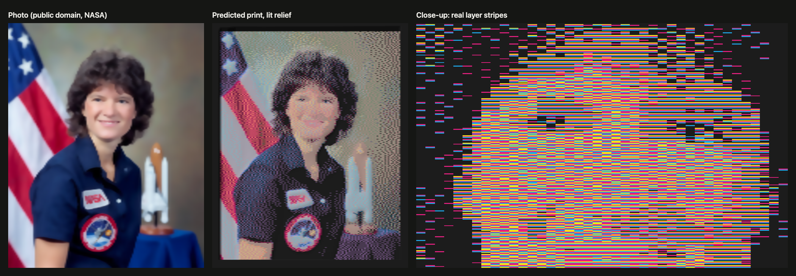

# Upright Mix Forge

A single-page browser tool that turns a photo into an upright, full-color plaque for the
Snapmaker U1, using Snapmaker Orca's **Full Spectrum** color mixing (alternating filament
layers that blend into new colors when seen from the side).

Everything runs locally in the browser. Just open `index.html` (or serve the folder, see below).



*The app's preview for a 100 mm plaque in cyan, magenta, yellow and black, with AI depth
relief and a 4 mm frame: the source photo, the predicted print as seen from a distance, and a
close-up of the actual alternating layer stripes. This is a prediction, not a photo of a print.*

*Sample photo: NASA, [official portrait of Sally Ride (1984)](https://commons.wikimedia.org/wiki/File:Sally_Ride_(1984).jpg),
public domain (work of the U.S. federal government), via Wikimedia Commons.*

## What it does

- **Image → printable colors:** builds every Cycle Mix your 4 filaments can make, picks the
  best set for the image, and maps the photo onto them (optional dithering, simplify,
  speck cleanup, black outlines, tone fitting).
- **Upright geometry:** each image row is one full mix cycle (e.g. 4 × 0.08 mm layers), each
  column a vertical strip, so the blend shows on the front face of a standing plaque.
- **3D relief:** sculpts the front from an AI depth estimate (Depth Anything V2, runs in the
  browser), the iPhone's own depth map read from Portrait-mode HEIC files, and/or brightness.
  Overhangs are capped at 45° so it prints without supports.
- **3MF export for Snapmaker Orca:** one object with a part per color, mix definitions embedded
  (`mixed_filament_definitions`), parts pre-assigned to mix slots 5, 6, …
- **Filament set finder:** tries every 4-spool combination from the spools you own on your image.
- **Swatch card + photo calibration:** print a strip of real mixes, photograph it, click the
  corner tiles, and the previews switch to your measured colors.
- **Fit to U1**, stand or **wall mount** (keyhole slots), optional **frame**, tool-change and
  time estimates.

## Using it with Snapmaker Orca

1. Start a **new project** (empty plate) with the U1 and your 4 filaments in slots 1–4, in the
   same order as the page.
2. **File → Import** the exported 3MF (don't Open it). Mixes arrive in **Color Mixing** as
   slots 5, 6, … and parts are already assigned.
3. Set layer height to **0.08 mm** (or whatever the page uses) and your real filament profiles.

## How the AI depth works (no API key)

The only AI feature, **Estimate depth with AI**, runs entirely on your computer. There is no AI
service behind it, so it needs no account or key.

1. The first time you use it, the page downloads the open-source
   [Transformers.js](https://github.com/huggingface/transformers.js) library from the jsDelivr CDN
   and the [Depth Anything V2 (small)](https://huggingface.co/onnx-community/depth-anything-v2-small)
   model (~27 MB) from Hugging Face's public model hub. Both are public downloads; no login.
2. The model runs inside the browser, on your GPU through WebGPU, or on the CPU (WebAssembly) if
   WebGPU isn't available. A photo takes about a second.
3. The browser caches the model, so later uses don't download it again.

**Your photos never leave your computer.** Depth estimation, HEIC conversion, color matching and
3MF export all happen in the page; the only network traffic is the one-time download of the
library, the model and the HEIC converter ([heic-to](https://github.com/hoppergee/heic-to)).

The small Depth Anything V2 model is licensed **Apache 2.0**. (The larger variants are
non-commercial, which is one reason the app uses the small one.)

iPhone Portrait-mode photos don't need the model at all: the page reads the depth map the iPhone
saved inside the HEIC file.

### Restyling photos

The app's own stylize tools (Simplify, Clean up specks, Black outlines) also run locally. If you
want a stronger look, such as pop art or a comic style, make it in any image editor or AI image
tool first and load the result. Tick **Keep this depth when I load another image** so the relief
still comes from the original photo. Ask for flat colors, no gradients and bold black outlines.

## Running locally

```bash
python3 -m http.server 8765
```

Then open http://localhost:8765. (Opening `index.html` directly also works; HEIC conversion and the
AI depth model download from a CDN on first use.)

Settings like your spool list and calibration are stored in the browser, per address. Use
**Save calibration file** to keep a copy.
